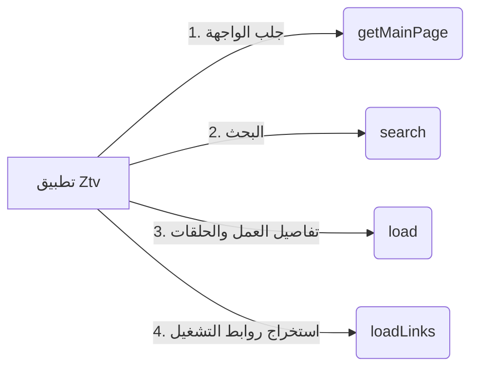

# دليل تطوير وصناعة إضافات Ztv & CloudiOS
## (Developer Guide for Ztv / CloudiOS Scraper Extensions)

يقدم هذا الدليل شرحاً تفصيلياً لكيفية برمجة وتطوير إضافات (Extensions / Providers) لتطبيق **Ztv** على نظام iOS باستخدام لغة **JavaScript** (محرك Apple JavaScriptCore الأصلي)، تماماً كما يتم في CloudStream.

---

### 1. كيف تعمل الإضافة؟ (Architecture Overview)

تطبيق Ztv يشغل الإضافات في بيئة معزولة فائقة السرعة، حيث يطلب من ملف الجافاسكريبت تنفيذ 4 دوال أساسية:


---

### 2. الدوال المساعدة المتاحة من تطبيق Ztv (Host APIs)

يوفر التطبيق دوال شبكية أصلية مدمجة داخل محرك الجافاسكريبت:
1. `httpGet(url, headers)`:
   * يقوم بعمل طلب HTTP GET فائق السرعة عبر iOS مع دعم الكوكيز والتوجيه التلقائي.
   * مثال:
     ```javascript
     var html = httpGet("https://example.com/movies", { "Referer": "https://example.com" });
     ```
2. `httpPost(url, body, headers)`:
   * يقوم بعمل طلب HTTP POST (مفيد للمواقع التي تستخدم فورم للبحث أو فك تشفير).
   * مثال:
     ```javascript
     var response = httpPost("https://example.com/api/search", "query=Batman", { "Content-Type": "application/x-www-form-urlencoded" });
     ```
3. `console.log(message)`:
   * يطبع الرسائل إلى سجل أخطاء التطبيق (Xcode Console).

---

### 3. الدوال الأربعة الإجبارية في كل إضافة (The 4 Core Functions)

#### 1) `getMainPage()`
تُرجع أقسام الصفحة الرئيسية (مثلاً: أحدث الأفلام، مسلسلات تركية، إلخ).
* **القيمة المرجعة:** مصفوفة من الأقسام `[ { name: String, items: [ { name, url, posterUrl } ] } ]`
```javascript
function getMainPage() {
    var sections = [];
    var html = httpGet(MAIN_URL);
    
    // استخراج العناصر من كود HTML بواسطة Regex
    var items = [];
    var regex = /<a href="([^"]+)"[^>]*>.*?]*>.*?<h3>([^<]+)<\/h3>/gi;
    var match;
    while ((match = regex.exec(html)) !== null) {
        items.push({
            name: match[3].trim(),
            url: match[1],
            posterUrl: match[2]
        });
    }
    
    sections.push({ name: "أحدث الإضافات", items: items });
    return sections;
}
```

#### 2) `search(query)`
تُستدعى عندما يبحث المستخدم عن اسم فيلم أو مسلسل.
* **القيمة المرجعة:** مصفوفة من البطاقات `[ { name, url, posterUrl } ]`
```javascript
function search(query) {
    var searchUrl = MAIN_URL + "/search?q=" + encodeURIComponent(query);
    var html = httpGet(searchUrl);
    var results = [];
    
    // استخراج نتائج البحث من كود الصفحة
    // قم بملء المصفوفة بالنتائج
    return results;
}
```

#### 3) `load(url)`
تُستدعى عند فتح صفحة تفاصيل الفيلم أو المسلسل لجلب القصة وسنة الإنتاج وقائمة الحلقات.
* **القيمة المرجعة:** كائن يحتوي على تفاصيل العمل والحلقات:
```javascript
function load(url) {
    var html = httpGet(url);
    
    var title = "اسم العمل";
    var plot = "قصة العمل...";
    var year = 2024;
    var episodes = [];
    
    // إذا كان مسلسلاً، نقوم باستخراج الحلقات
    // كل حلقة تحتوي على: { name: "الحلقة 1", url: "رابط صفحة الحلقة", episode: 1 }
    
    return {
        name: title,
        url: url,
        posterUrl: "https://...",
        plot: plot,
        year: year,
        type: episodes.length > 0 ? "tvSeries" : "movie",
        episodes: episodes
    };
}
```

#### 4) `loadLinks(url)`
وهي **أهم دالة**، حيث تستخرج روابط التشغيل المباشرة للفيديو (.mp4 أو .m3u8 أو Embed Player).
* **القيمة المرجعة:** مصفوفة من روابط السيرفرات:
```javascript
function loadLinks(url) {
    var html = httpGet(url);
    var links = [];
    
    // 1. استخراج روابط التشغيل المباشرة (Direct MP4 / HLS)
    var videoRegex = /<source\s+[^>]*src="([^"]+\.mp4)"[^>]*>/gi;
    var match;
    while ((match = videoRegex.exec(html)) !== null) {
        links.push({
            name: "سيرفر مباشر HD",
            url: match[1],
            headers: { "Referer": url }
        });
    }
    
    // 2. استخراج مشغلات الـ Embed (مثل Streamwish, DoodStream, إلخ)
    var iframeRegex = /<iframe[^>]*src="([^"]+)"/gi;
    while ((match = iframeRegex.exec(html)) !== null) {
        links.push({
            name: "مشغل وسيط سريع",
            url: match[1]
        });
    }
    
    return links;
}
```

---

### 4. حل مشكلة تغيير النطاقات (Dynamic Domain Mirrors)

لتفادي توقف الإضافة عند حجب النطاق، لا تقم بتثبيت نطاق واحد ثابت، بل استخدم مصفوفة نطاقات بديلة:
```javascript
var DOMAINS = [
    "https://ak.sv",
    "https://akwam.to",
    "https://ak.cc"
];

function getWorkingDomain() {
    for (var i = 0; i < DOMAINS.length; i++) {
        try {
            var res = httpGet(DOMAINS[i]);
            if (res && res.length > 100) return DOMAINS[i];
        } catch (e) {}
    }
    return DOMAINS[0];
}

var MAIN_URL = getWorkingDomain();
```

---

### 5. كيفية إضافة الإضافة إلى المستودع (`repo.json`)

1. احفظ ملف الجافاسكريبت في مستودعك على GitHub، مثلاً:
   `https://raw.githubusercontent.com/mehdikkoki-dot/T/main/MySite.js`
2. افتح ملف `repo.json` في المستودع وأضف الإضافة إلى القائمة:
   ```json
   {
       "name": "MySite",
       "url": "https://raw.githubusercontent.com/mehdikkoki-dot/T/main/MySite.js"
   }
   ```
3. افتح تطبيق **Ztv** وانتقل لتبويب **«الإضافات»** واضغط **تحديث**؛ ستظهر إضافتك فوراً وتعمل داخل التطبيق!
